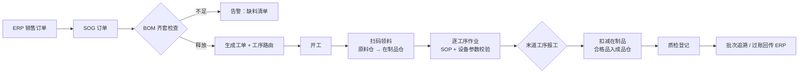
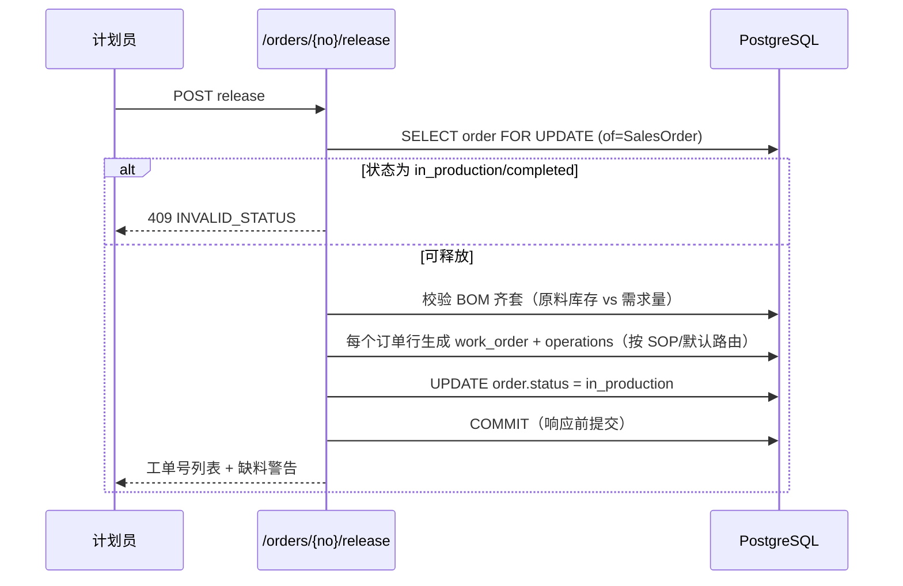
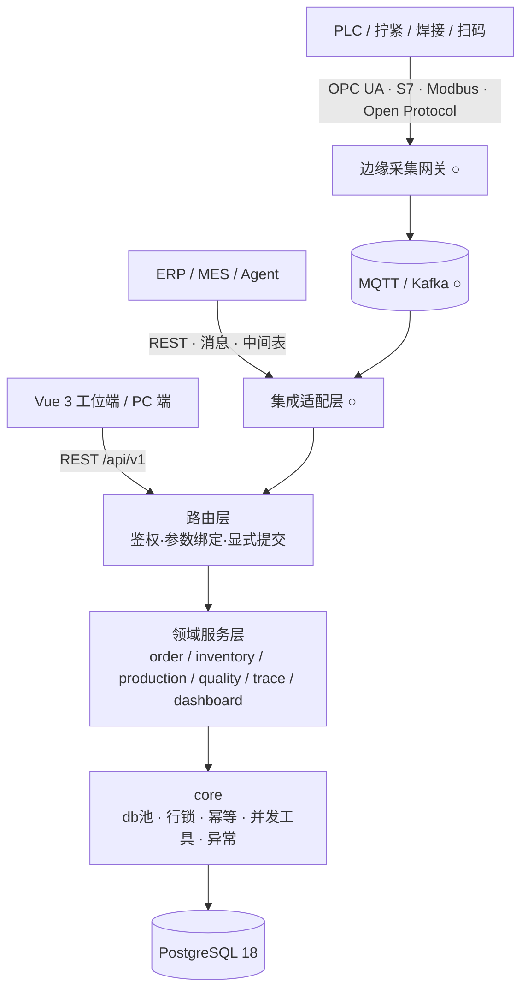
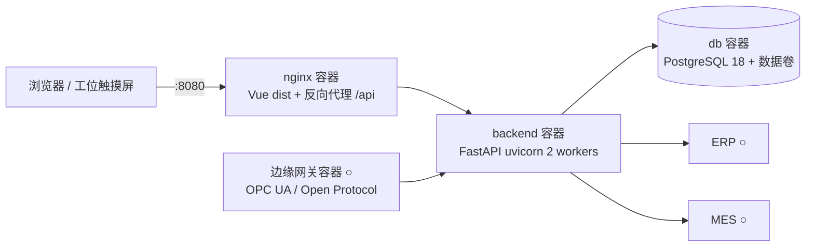
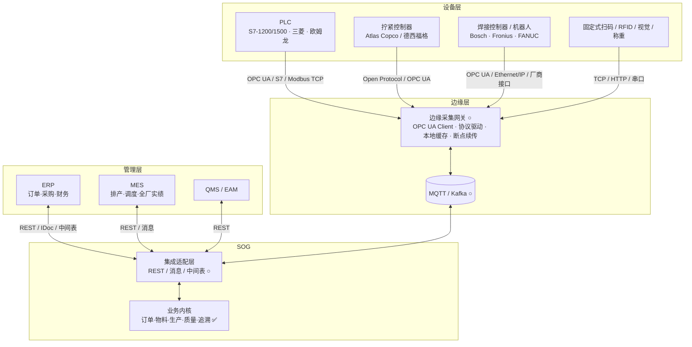
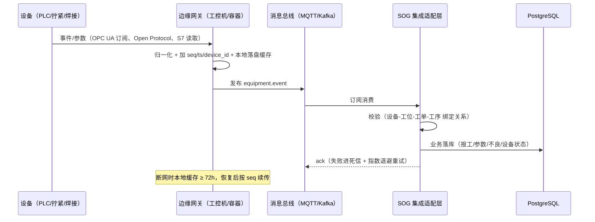

# SOG 离散装配生产作业支援系统 · 产品说明书

| 项目 | 内容 |
|---|---|
| 文档版本 | V2.0（四文档合并版） |
| 编制日期 | 2026-11-16 |
| 对应系统版本 | sog-system 0.1.0（FastAPI + Vue 3 + PostgreSQL 18） |
| 文档类型 | 产品说明书 / 技术方案（对外可交付） |
| 状态标记 | ✅ 已实现并验证　◐ 部分实现　○ 规划中（本期未实现） |
| 合并来源 | `architecture.md`、`SOG 离散装配生产作业支援系统技术方案.md`、`SOG系统产品说明书.md`（内容已全部并入本文） |

> 阅读提示：本文档描述**目标产品形态**与**当前代码实现**两条线。第 3、5、6、7 章逐项标注实现状态；第 8 章集成设计给出完整接口契约，其中「已实现」的能力对应现有 REST 接口，设备直连与 ERP/MES 对接为**本期规划、接口已预留**。凡属规划的章节均以 ○ 标注，不作"已上线"表述。

---

## 1. 产品概述

### 1.1 一句话定义

SOG（Standard Operation Guidance，标准作业指导系统）是面向**离散制造装配车间**的现场作业支援与执行闭环系统：向上承接 ERP 的销售订单与主数据、MES 的工单与工艺路线，向下直连 PLC、拧紧设备、焊接设备、扫码与视觉装置，把"订单—物料—工序—质量—批次"在工位端连成一条可执行、可核验、可追溯的链路。

### 1.2 系统定位（MOM 架构中的位置）

```
MOM 制造运营管理
├─ MES 生产执行：工单排产、报工实绩、产量追溯
├─ SOG 生产作业支援（本系统）—— 六项核心能力
│   ├─ ① 物料管理：原材料 / 半成品 / 在制品 / 成品 四态库存 · 入库出库 · 库存台账 · 流水
│   ├─ ② 齐套管理：BOM × 订单 × 库存 → 能否开工 / 缺什么 / 缺多少
│   ├─ ③ 订单管理：销售订单承接 · 行项 · 状态机 · 释放生成工单（系统内创建 / 外部协同获取）
│   ├─ ④ 生产管理：工单 · 工序路由 · 逐工序报工 · 领料 · 末道自动入库
│   ├─ ⑤ 质量管理：检验登记(PASS/FAIL/REWORK) · 一次合格率 · 不良 Top
│   └─ ⑥ SOP 作业指导：产品 + 工序 + 版本 下发 · 工位扫码即看
├─ QMS 质量管理（可由本系统质量模块扩展对接）
├─ EAM 设备管理（预留 OPC UA / 设备报警推送 SOP 对接）
└─ 物料 / 仓储管理
```

与传统内置简易作业模块的 MES 的区别：

| 对比项 | MES | 本 SOG 系统 |
|---|---|---|
| 重心 | 排产、工单执行、报工采集、产量统计 | 现场作业指引 + 物料齐套 + 进度/质量/追溯闭环 |
| 数据粒度 | 工单 / 产线 | **批次（batch）+ 工序（operation）** |
| 现场价值 | 计划达成 | 操作工不用翻纸质图纸，扫码即看 SOP、报工即入账、异常可追溯 |

核心定位：**轻工单、重现场资料与异常协同**，重心在**现场数据贯通与辅助决策**——订单 → 物料齐套 → 工单执行 → 质量处置 → 追溯闭环。

### 1.3 解决的现场问题

| 序号 | 现状痛点 | SOG 的应对 |
|---|---|---|
| 1 | 纸质图纸/工艺卡版本混乱，用错版 | SOP 按「产品 + 工序 + 版本」在线下发，工位端强制确认阅读，改版自动提醒 |
| 2 | 领料靠口头/Excel，原料与在制品账实不符 | 原料仓 → 半成品仓 → 在制品仓 → 成品仓的批次级出入库过账，四态库存实时余额 + 全量流水 |
| 3 | 报工靠班后补录，产量与进度滞后 | 工位端扫码/设备触发即时报工，末道工序自动入库，进度秒级刷新 |
| 4 | 扭矩、焊接参数靠人盯，漏拧/错程序无法拦截 | 拧紧程序号与工艺绑定校验，结果 NOK 阻断报工；焊接参数超差记不良 |
| 5 | 客诉时无法定位问题批次与上游原料 | 成品批次 → 在制品批次 → 原料批次的双向追溯，秒级出链路 |
| 6 | 订单交期靠电话追问 | 订单执行状态与工单进度同屏可视，齐套缺口提前暴露 |

### 1.4 产品定位与周边系统边界

| 系统 | 主要职责 | 与 SOG 的边界 |
|---|---|---|
| ERP（SAP / 用友 / 金蝶 / Oracle） | 销售订单、采购、财务成本、总账 | ERP 管**商务与财务**；SOG 接收销售订单与主数据，回传领料/入库/完工/报废过账，不承担成本核算 |
| MES | 排产、工单调度、产能与 OEE、全厂级实绩 | MES 管**计划与全厂调度**；SOG 管**工位级作业执行与作业指导**。二者可嵌套（SOG 作为 MES 的作业支援子模块）或并列协同（MES 下发工单，SOG 回传执行实绩） |
| QMS | 检验标准体系、SPC、质量成本、客诉流程 | SOG 做**现场检验执行与不良记录**；QMS 做体系化质量分析与放行决策 |
| WMS | 库位、上架、拣选、盘点 | SOG 只做**线边四态库存（原料/半成品/在制品/成品）与批次流水**；立体库/库位管理归 WMS |
| EAM | 设备台账、维保计划、备件 | SOG 采集**设备运行与工艺参数**并承接点检/故障上报；台账与维保工单归 EAM |
| 工业 Agent / OPC UA 平台 | 数据汇聚、AI 诊断、知识库 | SOG 提供作业上下文与 SOP，Agent 侧做推理与推送（报警→自动调出 SOP 与故障指引） |

> 一句话边界：**ERP 管钱和单，MES 管计划和产，SOG 管工位怎么干、干得对不对、出了事查得到。**

### 1.5 目标行业与场景

- 汽车零部件装配（减速机、电机、泵阀、线束、座椅）
- 装备与机电组装（多工序、多工位、扭矩/焊接关键工序）
- 3C 与家电总装（扫码防错、程序校验）
- 适用形态：多品种小批量 + 关键工序强管控；工位配触摸屏/平板/工控机

### 1.6 核心价值（可量化口径）

| 指标 | 典型改善方向 | 度量方式 |
|---|---|---|
| 错版工艺导致的返工 | 归零 | 旧版 SOP 使用次数 / 工艺变更确认率 |
| 账实差异 | 从"班结"到"实时" | 库存流水与实物抽盘差异率 |
| 报工时效 | 从小时级到秒级 | 报工时间戳 − 实际完工时间 |
| 关键工序不良流出 | 拦截在工位 | NOK 阻断报工次数 / 客户端零公里不良 |
| 追溯定位耗时 | 从数小时到秒级 | 输入成品批次到输出完整链路的时间（实测 11–16 ms） |

---

## 2. 用户与角色

| 角色 | 典型岗位 | 主要操作 | 终端 |
|---|---|---|---|
| 管理员 admin | IT / 系统管理员 | 用户与主数据维护、看板、全部查询 | PC |
| 计划员 planner | 生产计划、订单管理 | 订单创建与释放、齐套检查、工单跟踪 | PC |
| 操作工 operator | 装配工、工位长 | 开工、领料确认、报工、看 SOP、异常上报 | 工位触摸屏 / 平板 |
| 质检员 quality | IQC/IPQC/OQC | 首检/过程检/终检登记、不良代码判定 | 工位屏 / PC |
| 仓管 warehouse | 线边库 | 入库、领料、调账、盘查 | PC / 手持终端 |

### 2.1 权限模型

- **当前实现 ◐**：账号密码登录，bcrypt 存哈希（演示数据内置 4 个账号），写操作按角色字段校验；操作人由 `X-Operator` 请求头透传（`core/deps.get_operator`，默认 `system`）。
- **规划 ○**：JWT Bearer 鉴权、按钮级权限矩阵、工位与操作工绑定（`stations` + `users.station_code`）。

| 账号 | 密码 | 角色 |
|---|---|---|
| admin | admin123 | 管理员 |
| planner | planner123 | 计划员 |
| operator | op123 | 操作工（ST-01） |
| quality | qc123 | 质检员 |

---

## 3. 功能地图与实现状态

以下六项为 SOG 的**核心能力主干**，其余能力（追溯、看板、集成）作为支撑与输出能力挂靠其后。

```
SOG 系统核心能力
├── ① 物料管理（四态库存 + 全流程入出库）
│   ├── 物料主数据：原材料 RAW / 半成品 SEMI / 在制品 WIP / 成品 FINISHED
│   │                                                  ◐ RAW·WIP·FINISHED ✅ / SEMI ○
│   ├── 入库（采购入库 / 半成品入库 / 成品入库）        ✅（inbound，按批次 + 库位）
│   ├── 出库（领料 / 报废 / 调整）                      ✅（issue / scrap）　○ 盘盈亏调整
│   ├── 库存管理（批次级台账、流水、安全库存预警）       ✅（inventory / transactions / low-stock）
│   ├── BOM 维护（父子件、单机用量、版本、损耗率）       ○（规划，齐套的前置依赖）
│   └── 数据来源：系统内创建 或 外部协同获取            ✅ 系统内创建　○ 外部同步
├── ② 齐套管理（BOM × 订单 → 物料需求展开）
│   ├── 订单齐套校验（按订单行成品展开 BOM 算需求）      ○（当前仅按订单行物料直查可用量）
│   ├── 齐套结果分级（齐套 / 缺料 / 短少量 + 缺料清单）  ○
│   ├── 齐套看板与按优先级排序（产线可开工队列）         ○
│   └── 齐套与订单释放联动（缺料时阻断或告警放行）       ◐ 缺料告警 ✅ / 阻断策略 ○
├── ③ 订单管理
│   ├── 销售订单创建 / 查询 / 详情                      ✅（POST/GET/PUT /api/orders）
│   ├── 订单行项目（成品 + 数量 + 单价）                ✅
│   ├── 状态机流转（DRAFT→RELEASED→IN_PROGRESS→COMPLETED→CLOSED） ✅
│   ├── 草稿编辑乐观锁（?version=）                     ✅
│   ├── 释放生成工单（按订单行拆工单、幂等防重）         ✅
│   └── 数据来源：系统内创建 或 外部协同获取            ✅ 系统内创建　○ ERP / 协同平台同步
├── ④ 生产管理
│   ├── 工单创建 / 状态流转（PLANNED→RELEASED→RUNNING→DONE） ✅
│   ├── 工序路由（route，JSONB，默认 5 道工序）          ✅
│   ├── 逐工序报工（按工序累计合格数推进）               ✅
│   ├── 报工领料（消耗原料批次 + 反写追溯事件）          ✅
│   ├── 报工幂等键（同键重复提交仅生效一次）             ✅
│   ├── 报工/报废联动库存                              ✅
│   ├── 末道工序完工自动入成品仓                        ✅
│   └── 批量报工 / 跨工单并行报工                        ○（规划）
├── ⑤ 质量管理
│   ├── 检验登记（检验项 / 结果 PASS·FAIL·REWORK）       ✅
│   ├── 不良代码与描述                                  ◐ 字段 ✅ / 代码库图册 ○
│   ├── 一次合格率统计与不良 Top                         ✅（quality-stats）
│   └── 首检 / 过程检 / 终检细分                        ○（规划）
├── ⑥ SOP 作业指导
│   ├── 按产品 + 工序 + 版本下发                        ○
│   ├── 步骤 / 检查点 / 扭矩与工装要求                  ○
│   ├── 工位扫码即看（图片 / 视频 / 图纸）              ○
│   └── 阅读确认与改版提醒                              ○
└── 支撑能力
    ├── ⑦ 生产追溯：正反向批次事件流 ✅ / 树形展开 ○
    ├── ⑧ 生产总览看板（KPI / 趋势 / 分布）              ○
    └── ⑨ 集成与设备接入（ERP / MES / PLC / 拧紧 / 扫码） ○
```

> **齐套是 SOG 的核心能力而非附属功能**：离散装配车间的真实痛点是「订单来了不知道能不能开工」。齐套 = 订单（要什么）× BOM（用什么）× 库存（有多少）三者的交集运算，它把「物料管理」和「订单管理」从两张孤立台账变成可决策的开工依据。因此本节将其单列为 ② 级能力，与物料、订单并列。

### 3.0 核心能力闭环关系

六项核心能力构成一条**由订单驱动的物料—生产闭环**：

```
订单（③） ──展开──▶ 齐套（②） ──放行──▶ 生产（④） ──检验──▶ 质量（⑤）
   │                    ▲                    │                    │
   │                    │                    ▼                    │
   └── 需求来源         └── 库存供给 ◀── 物料（①） ◀── 领料/入库 ─┘
                                          │
                                          └── 作业依据 ◀── SOP（⑥）
```

- **物料（①）** 是供给底座，四态库存为齐套提供可用量，为生产提供领料来源。
- **订单（③）** 是需求源头，同时向外提供「外部协同获取」入口（ERP / 协同平台）。
- **齐套（②）** 是决策中枢，只有它齐套通过，生产才被放行。
- **生产（④）** 是执行主体，逐工序报工驱动库存由原料 → 在制 → 成品流转。
- **质量（⑤）** 是守门环节，检验结果反向决定是否可入库、是否需返工。
- **SOP（⑥）** 是作业依据，工位打开即看，保证「干得对」。

### 3.1 当前代码实现范围（务必先读）

实际 `backend/app` 为**三模块、9 表 1 视图**的实现，REST 前缀 `/api`（非 `/api/v1`）。**以下为已通过接口层端到端冒烟验证（35/35）的实况**：

| 模块 | 前缀 | 能力 |
|---|---|---|
| 订单管理 | `/api/orders` | 建单（含行项）、分页列表、详情、按单号查、草稿编辑（乐观锁）、状态机流转、**释放生成工单（幂等防重）**、**缺料告警** |
| 物料管控 | `/api/materials` | 主数据、入库、预留、释放、领料、**报废**、库存台账、流水、低库存预警、**未指定批次时 FIFO 自动选批** |
| 生产管理 | `/api/production` | 工单创建/列表/详情、状态流转、**工序路由**、**逐工序报工**、**报工领料（扣原料 + 写追溯）**、**报工幂等键**、报废、进度、质量检验、质量统计、正反向追溯、追溯树 |

**已实现的关键闭环**（此前文档误标为规划态，实为已实现）：

- ✅ **订单释放生成工单**：按订单行拆工单，缺料仅告警不阻断，重复释放返回既有工单（幂等）
- ✅ **工序路由**：`work_order.route` 以 JSONB 存工序序列，未传时用默认 5 道工序
- ✅ **逐工序报工**：超产校验按**当前工序**累计数判断；`done_qty` 仅在末道工序推进
- ✅ **报工领料**：报工可传 `materials` 明细，按 FIFO 或指定批次扣减原料，并为每个消耗批次写 `ISSUE_MATERIAL` 追溯事件
- ✅ **末道工序自动入成品仓**：末道累计达计划量即完工，自动入库 + 生成成品批次号
- ✅ **报工幂等**：`idempotency_key` 同键重复提交仅生效一次（返回「重复提交已忽略」）

**确实尚未实现**：

- ○ **BOM 表与 BOM 驱动的齐套展开**（当前齐套仅为「按订单行物料直查可用量」）
- ○ **半成品物料类型 SEMI**（当前仅 RAW / WIP / FINISHED 三态）
- ○ **物料主数据与订单的外部协同获取**（ERP / 协同平台同步）
- ○ **SOP 作业指导**（无任何表与接口）
- ○ **生产总览看板**（后端无看板聚合接口，前端无看板页）
- ○ 批量/跨工单并行报工、不良代码库与处置图册、首检/过程检/终检细分、追溯树深度展开交互
- ○ JWT 鉴权、`/api/v1` 版本化、ERP/MES/设备集成驱动

---

## 4. 端到端业务流程

### 4.1 主流程



### 4.2 订单释放 → 工单（目标形态）



要点：齐套不足**不阻断**释放，只返回 `warnings`；重复释放由状态机 + 行锁拦截（实测稳定 409）。

### 4.3 领料（原料 → 在制品，目标形态）

1. `SELECT` 原料仓批次余额 `FOR UPDATE (of=InventoryBalance)`；
2. 原料仓扣减，写 `inventory_transactions(tx_type=issue)`；
3. WIP 仓按**原料物料**增加，批次固定 `WIP-{工单号}`；
4. 写 `trace_links(relation=consumed, batch_no=WIP批次, parent_batch=原料批次)`。

> 该设计使「一次领料 N 套」可流过全部工序，符合装配现场实际。

**当前实现**：`POST /api/materials/issue` 在 `inventory` 行上加 `FOR UPDATE` 锁（`MaterialRepository.lock_inventory`），先冲减 `qty_reserved` 再冲减 `qty_on_hand`，并写 `stock_transaction(txn_type=OUT)`，含 `ref_type / ref_id` 关联单据。

### 4.4 报工（仅末工序动库存，目标形态）

```
报工请求 → 幂等键查重（命中直接返回 duplicated=true）
        → 工单行锁 FOR UPDATE (of=WorkOrder)
        → 工序状态推进（pending → in_progress → completed）
        → 若为最大 seq 的末工序：
            扣减 WIP 仓（按激活 BOM 各组件 × 合格数）
            合格品入成品仓，批次 FG-{工单号}-{日期}
            累计 produced/qualified/scrap，工单置 completed
        → COMMIT
```

为什么只在末工序扣 WIP：中间工序若逐道扣减，会出现「第一道就扣光 WIP」的库存不足；离散装配的实际语义是**领料一次、末道入库**。

**当前实现**：`POST /api/production/work-orders/{id}/report` 校验工单为 `RUNNING`、累计合格+报废不超过计划量，累加 `done_qty`、写 `production_progress` 与 `trace_record(event_type=ASSEMBLE)`、`version+1`；`/scrap` 累加 `scrap_qty` 并写 `trace_record(event_type=SCRAP)`。尚不联动库存。

### 4.5 追溯

```
反向：成品批次 → produced 链取 parent（WIP 批次）
              → WIP 批次按 consumed 展开到各原料批次（BFS，按层查询）
              → 组装树（CPU 线程池 run_cpu_bound 构建）
正向：原料批次 → 所有以它为 parent 的 consumed 记录，扩散到下游 WIP / 成品
```

实测：5 节点、深度 2、11–16 ms。

**当前实现**：`trace_record` 以 `product_batch` / `material_batch` 两个维度索引，提供 `GET /api/production/trace/forward`（按成品批次查）与 `/trace/backward`（按物料批次查），返回事件明细 `detail`（JSONB）。

### 4.6 关键子流程与业务规则

| 环节 | 核心规则 | 异常处理 |
|---|---|---|
| 订单创建 | 订单号唯一，状态初始化 `DRAFT`；行项目 `line_no` 在同一订单内唯一 | 业务键重复 → 400 |
| 订单编辑 | 仅 `DRAFT` 可编辑；`?version=` 与当前版本比对 | 非草稿 → 409；版本不一致 → 409 提示刷新重试 |
| 订单释放 | 只有可释放状态允许；订单行物料必须是成品；按激活 BOM 计算需求量比对原料库存 | 齐套不足**只告警不阻断**（`warnings`）；重复释放 → **409 `INVALID_STATUS`** |
| 领料 | 原料仓按批次扣减 + 在制品仓按「原料物料 + `WIP-{工单号}` 批次」增加；同时写流水与追溯边 | 库存不足 → **400 `INSUFFICIENT_STOCK`**；工单已完工 → 409 |
| 预留 / 释放预留 | 行锁下校验可用量（在手 − 预留） | 预留超可用 → 400 / 409；释放超已预留 → 409 |
| 报工 | 幂等键唯一；工单行锁串行化；按工序 seq 推进；**仅末道工序**扣减在制品并入库 | 数量为 0 → 400；重复提交 → 原记录 `duplicated=true`；合格+报废超计划 → 409 |
| 末道入库 | 按激活 BOM 各组件 × 合格数扣在制品；成品批次 `FG-{工单号}-{YYYYMMDD}` | 在制品不足 → 400，提示缺哪个组件 |
| 报废 | 仅 `RUNNING` 工单可报废；累计不超计划量 | 超计划 → 409 |
| 质检 | 检验项 + 标准 + 实测值 + 判定 + 不良代码 | 不良必须挂不良代码，便于 Top 分析 |
| 追溯 | 成品批次的 `produced` 边取在制品父批次，再按 `consumed` 边展开原料 | 无追溯边返回空树并提示，不报错 |

### 4.7 状态机

| 对象 | 状态流转（当前实现） |
|---|---|
| 销售订单 | `DRAFT` → `RELEASED` → `IN_PROGRESS` → `COMPLETED` → `CLOSED`；`DRAFT/RELEASED/IN_PROGRESS` 可转 `CANCELLED`（终态） |
| 生产工单 | `PLANNED` → `RELEASED` → `RUNNING` → `DONE` / `SCRAPPED`（后两者终态） |
| 库存事务 | `IN`（入库）/ `RESERVE`（预留）/ `RELEASE`（释放）/ `OUT`（领料出库）/ `SCRAP`（报废） |
| 追溯事件 | `ISSUE_MATERIAL` / `WORK_START` / `ASSEMBLE` / `INSPECT` / `PACK` / `SCRAP` |
| 工序（route 内，已实现） | `pending` → `in_progress` → `completed` |
| 齐套状态（规划） | `KIT_READY` / `KIT_SHORT` / `KIT_UNKNOWN` |
| 库存事务（规划扩展） | 增加 `produce_out`（在制品消耗）/ `produce_in`（成品入库）/ `ADJUST`（盘盈亏调整） |

状态机以白名单表实现（`orders/service.py` 的 `TRANSITIONS`、`production/service.py` 的 `WO_TRANSITIONS`），非法流转抛 `ConflictException`（409）。

---

## 5. 功能详述

### 5.1 登录与权限 ◐

- 账号密码登录，bcrypt 存哈希（演示数据内置账号）。
- 规划 ○：签发 JWT（默认 720 分钟），未登录访问业务接口返回 401，前端路由守卫拦截跳转。
- 当前 ◐：操作人取 `X-Operator` 头，默认 `system`；写操作无强制鉴权。

### 5.2 生产总览（看板）○

> 现状：后端无看板聚合接口，前端无看板页。本节为目标形态设计。

- KPI：订单总数/在产、工单总数/在执行、今日合格产出、今日一次合格率、低于安全库存物料数。
- 图表：近 7 天合格/不良趋势（按本地日聚合）、工单状态分布。
- 列表：低库存预警、不良 Top 5、**齐套告警队列**（见 5.4A，缺料订单按优先级排序）。
- 性能目标：多路统计**并行查询**（`asyncio.gather` + `gather_limited`），单次 6–22 ms（参考实现实测）。

与 ②「齐套看板」的分工：本节的齐套部分只做**告警摘要**（缺料订单条数与前 5 条）；完整的齐套明细、缺口清单、可开工队列归 5.4A 齐套管理的独立页面承载。

### 5.3 订单管理 ✅

- 列表：订单号、客户/产品型号、优先级（1–5）、计划日期、状态；支持状态与客户筛选、分页。
- 新建：客户、产品型号、优先级、计划日期、备注 + 多订单行（物料编码/名称/规格/数量/单位/行号）。
- 编辑：仅草稿可改，`?version=` 乐观锁。
- 流转：`POST /api/orders/{id}/transition?target=`，非法流转 409。
- 规则：订单号由服务生成（`SO-{yyyyMMddHHmmss}-{随机}`）且唯一；优先级 `CHECK 1..5`。
- ✅ **释放生成工单**：`POST /api/orders/{id}/release`，按订单行拆工单，返回缺料告警（**不阻断释放**）；重复释放为**幂等**，直接返回既有工单而不报 409。
- ✅ **按单号查询**：`GET /api/orders/no/{order_no}`，便于外部系统按单据号回查。
- ○ 外部协同获取：预留 ERP / 协同平台推送接口（见 5.3A）。
- 前端：列表/新建/编辑/流转/释放齐全，释放后展示缺料告警与生成工单数。

### 5.3A 物料与订单的双来源接入（系统内创建 / 外部协同获取）○

**双来源原则**：物料主数据与销售订单**既可以在 SOG 内手工创建，也可以从外部系统（ERP / 供应商协同平台 / 集团主数据平台）同步获取**。两条入口写入同一张表，靠**来源标识**区分，避免主数据在两处各自演进、互相覆盖。

**来源标识字段**（需在 `material` 与 `sales_order` 各补 3 个字段）：

| 字段 | 说明 |
|---|---|
| `source_type` | `LOCAL`（系统内创建）/ `ERP` / `SUPPLIER` / `PDM`（外部来源） |
| `source_ref` | 外部唯一键（ERP 物料号 / 订单号），用于幂等 upsert |
| `synced_at` | 最近一次同步时间；`LOCAL` 记录为空 |

**幂等 upsert 规则**（关键）：

- 外部写入以 `(source_type, source_ref)` 为幂等键，**存在则更新、不存在则新增**，绝不重复插入。
- 唯一键冲突处理：若本地已用同一 `code` 手工建过物料，外部同步到来时按 `code` 命中而非新建，并把 `source_type` 回填为外部来源，避免同一物料两条记录。
- `LOCAL` 记录被外部来源覆盖时，可在 `attrs` 中保留本地补充字段（如现场工艺参数），同步只更新外部负责的字段（名称/规格/单位），不整行覆盖。

**同步方式**：

- **推送式**（推荐）：外部系统调 `POST /api/integration/materials/bulk`、`POST /api/integration/orders/bulk`，支持批量 upsert，返回「新增 / 更新 / 跳过 / 失败」四类计数。
- **拉取式**：SOG 定时任务按 `source_ref` 增量拉取，适合对方无推送能力时。
- **实时单条**：`POST /api/integration/orders` 适配单据量小的协同场景。

**冲突与治理**：

- 外部来源记录在 SOG 内**默认只读**（禁止界面编辑关键字段），需改主数据须回源系统修改后再同步，保证单一数据源。
- `LOCAL` 记录允许在 SOG 内编辑，但若后续被外部同步命中同一 `code`，需人工确认归属，系统给出冲突提示。
- 所有外部同步写操作记入 `audit_log`（来源系统、批次号、操作结果）。

**与齐套的关系**：外部同步来的订单可直接参与齐套计算；若其物料尚未建 BOM，齐套结果为 `KIT_UNKNOWN`（见 5.4A），提示补建 BOM 而非误判为缺料。

### 5.4 物料主数据与 BOM ◐

- 物料字段：编码、名称、类型、规格、单位、安全库存、`attrs`（JSONB 扩展属性）。
- 物料类型 ◐：当前枚举为 `RAW`（原材料）/ `WIP`（在制品）/ `FINISHED`（成品）；**`SEMI`（半成品）尚未实现**，落地方案见 5.4.1。
- BOM ○：按成品维护激活版本，组件 + 单机用量 + 顺序（支持 1/1/4 这类多件用量）；校验产品必须为成品、组件不能是自身、同一产品仅一个激活版本。
- 需求口径：BOM 用量 1/1/4，示例成品 `FG-A001`。

#### 5.4.1 四态物料类型补齐（SEMI 半成品）○

半成品是离散装配的关键形态（如已装配但未拧紧/未检验的组件、外协回来的部件），它既不是原料也不是成品，需要独立类型才能正确参与齐套与库存归属。

| 类型 | 含义 | 典型来源 | 典型去向 | 库存仓 |
|---|---|---|---|---|
| `RAW` | 原材料 | 采购入库、外部协同 | 领料上工位 | 原料仓 WH-RAW |
| `SEMI` | 半成品（可入库的可复用件） | 本厂前道工序完工、外协入库 | 作为组件参与上层装配 | 半成品仓 WH-SEMI |
| `WIP` | 在制品（已上线未完工） | 领料开工后产生 | 继续加工、检验 | 在制仓 WH-WIP |
| `FINISHED` | 成品 | 末道工序完工自动入库 | 发货出库 | 成品仓 WH-FIN |

落地要点：`MaterialType` 增加 `SEMI`；`location` 约定新增 `WH-SEMI`；BOM 组件允许 `RAW` 与 `SEMI`；齐套展开时若组件类型为 `SEMI` 则查半成品仓可用量。改动涉及枚举、schema（含 CHECK 或枚举约束）、库存视图与齐套逻辑，共 4 处。

### 5.4A 齐套管理 ○

**定位**：齐套是 SOG 的核心决策能力，回答「这张订单现在能不能开工、缺什么、缺多少」。

**业务定义**：齐套 = 订单需求（要什么、多少）× BOM（每台用什么、用多少）× 库存可用量（现有多少）三者求交。

**计算逻辑**（目标实现）：

```
对每个订单行（成品 P，数量 N）：
  Need(p, q) = BOM(P, 激活版本).qty(1 + 损耗率) × N
  合并在手需求（同成品多订单行合并，避免重复占用）
  Available(q) = Σ 批次可用量（已扣预留）  ← 复用 v_inventory_available 视图
  Shortage(q) = max(0, Need(q) - Available(q))
  齐套状态：
     全部 Shortage == 0            → KIT_READY   齐套
     存在 Shortage > 0            → KIT_SHORT   缺料（附缺料清单）
     物料未建 BOM 或主数据          → KIT_UNKNOWN 无法判定
```

**结果分级与呈现**：

- `KIT_READY` 齐套：显示可开工数量，允许释放/开工。
- `KIT_SHORT` 缺料：列出每个缺料组件的「需求 / 可用 / 缺口」三级明细，给出建议采购量与最早可齐套日期。
- `KIT_UNKNOWN` 无法判定：提示补建 BOM 或物料主数据，不阻断但标黄。

**与订单释放的联动策略**（可配置）：

- `WARN` 告警放行（**当前实现口径**）：缺料仅返回 `ShortageOut` 列表，工单照常生成。
- `BLOCK` 阻断：`Shortage` 非空时拒绝释放并返回 409 + 缺料清单。
- `PARTIAL` 部分放行：按齐套率拆单，齐套部分先释放，缺口部分留待补料。

**库存占用口径**：齐套校验只读不写（不锁库存、不做预留），避免校验动作干扰正常库存事务；若需「校验即占用」，应由独立的「订单预留」接口显式执行，并计入 `Available` 的扣减口径。

**性能**：单订单齐套为 O(订单行 × 平均 BOM 组件数)，可用 `gather_limited` 并行预取各组件可用量；批量齐套（如整条产线的待产订单队列）按订单并行、组件可用量缓存于单次请求内，避免 N 次重复查询。

### 5.5 库存管理（四态）✅ / ○

四态库存（○：半成品仓待 SEMI 类型落地后启用）：

| 仓库/库位 | 编码 | 对应物料类型 | 用途 | 状态 |
|---|---|---|---|---|
| 原料仓 | WH-01（默认） | RAW | 采购入库、生产领料扣减 | ✅ |
| 半成品仓 | WH-SEMI | SEMI | 前道完工/外协入库，供上层装配领用 | ○（随 SEMI 类型补齐） |
| 在制品仓 | WH-01 | WIP | 领料转入、末道消耗 | ✅ |
| 成品仓 | FG-01 | FINISHED | 末道合格品自动入库、发货 | ✅ |

> 库位编码以代码常量为准：`material.service` 默认库位 `WH-01`，`production.service` 常量为 `WIP_LOCATION="WH-01"`、`FINISHED_LOCATION="FG-01"`。

当前实现以 `inventory.location`（默认 `WH-01`）+ `batch_no` 定位库存行：

- 唯一键：`(material_id, batch_no, location)`，并校验 `qty_on_hand >= 0`、`qty_reserved >= 0`。
- 可用量视图：`v_inventory_available`（可用 = 在手 − 预留），联动 `safety_stock` 预警。
- 流水：`stock_transaction(txn_type, qty, balance_after, ref_type, ref_id, operator, remark)`，全量可审计。
- 操作：入库（同批次累加）、预留、释放预留、领料（先冲预留再冲在手）、报废。
- ✅ **FIFO 自动选批**：领料/报工领料时未指定 `batch_no`，按批次创建时间先进先出自动扣减，避免现场必须手动选批。
- ✅ **并发安全**：`SELECT ... FOR UPDATE (of=Inventory)` 锁定库存行，杜绝并发超扣。
- 安全库存：`GET /api/materials/low-stock` 聚合 `SUM(在手 − 预留) < safety_stock` 的物料。
- 规划 ○：`GET /inventory/kit-check/{product_code}` 齐套检查接口、调整（`/adjust`）盘盈亏单据、半成品仓纳入台账。

### 5.6 生产工单与作业 ✅

- 工单：`wo_no`（`WO-{yyyyMMddHHmmss}-{随机}`）、产品编码/名称、计划量、完工量、报废量、产线、工位、`route`（JSONB 工艺路线）、计划起止、状态、`version`。
- 列表与详情、状态流转（`PLANNED→RELEASED→RUNNING→DONE/SCRAPPED`）。
- ✅ **工序路由**：`route` 存工序序列（默认 5 道：上料 ST-01 / 装配 ST-02 / 拧紧 ST-03 / 检验 ST-04 / 包装入库 ST-05），每道含 `seq / name / station / status / started_at / finished_at`，报工后回填 `good_qty / bad_qty`。
- ✅ **逐工序报工** `POST /api/production/work-orders/{id}/report`：
  - 需传 `seq` 指定工序；`seq` 缺省时取当前未完工的首道工序。
  - **超产校验按当前工序累计数**判断（`工序已合格 + 报废 + 本次 > 计划` 才拒绝），中间工序不推进工单 `done_qty`。
  - 报工后自动回填每道工序的 `good_qty / bad_qty`，并在工序累计达标时置 `completed`。
- ✅ **报工领料**：`materials` 明细传入本次消耗的原料（`material_id / batch_no / location / qty`），系统按 FIFO 或指定批次扣减，并为每个消耗批次写 `ISSUE_MATERIAL` 追溯事件（含 `material_batch`），使反向追溯可闭环。
- ✅ **报工幂等键**：`idempotency_key` 同键重复提交仅生效一次，返回「重复提交已忽略」，不重复扣料、不重复计数。
- ✅ **报废**：`POST /{id}/scrap` 单独登记报废量并联动库存。
- ✅ **末道自动入库**：末道工序累计合格数达计划量即判完工（`DONE`），自动写入成品仓并生成成品批次号（可传 `product_batch` 指定）。
- 前端：工单页支持工序下拉、领料明细动态行（添加/删除行），提交时仅上送填写完整的领料行。
- 规划 ○：`一键报完剩余工序`（按 seq 顺序）、跨工单并行报工 `POST /work-orders/report/multi`（信号量限流 8）、批量报工。

### 5.7 质量管理 ✅ / ◐

- 登记：工单、检验项、结果（PASS / FAIL / REWORK）、不良代码、不良描述、缺陷图片（JSONB 预留）、检验人、备注。
- 统计：检验总数、判定分布、不良代码 Top。
- 不良代码库 ◐：`defect_code` + `defect_desc` 字段已支持判定与 Top 分析；独立不良代码表（`code / name / category / disposal_guide`，如 `D-003 扭矩不足 → 重新拧紧至 25N·m 并复检`）与不良图册 ○。
- 规划：检验类型细分首检/过程检/终检、检验项与标准字典、不良代码 × 工序强关联。

### 5.8 SOP 作业指导 ○

- 内容模型：`产品 + 工序 + 版本`，步骤含标题、描述、检查点、扭矩要求、媒体（预留）。
- 下发：工位端按当前工序自动匹配；无该工序 SOP 时按路由顺序兜底。
- 阅读确认：记录确认人；工艺改版后未确认用户提示弹窗。
- 对工业 Agent 的接口预留：`GET /sops/{product_code}/{op_code}` 拉取 SOP 与不良处置指引。

### 5.9 生产追溯 ✅ / ◐

- 当前实现：`GET /api/production/trace/forward?product_batch=`（成品批次 → 物料/工单）、`GET /api/production/trace/backward?material_batch=`（物料批次 → 成品工单），返回 `trace_record` 事件流。
- 规划 ○：树形链路（成品 → 在制品 → 原料，含数量、工单、订单）+ 关联报工与质检记录；正向扩散到所有下游批次；树构建放 CPU 线程池不阻塞事件循环。
- 性能（参考实现）：5 节点/深度 2 实测 8.8–16 ms。

### 5.10 系统与审计 ◐

- `GET /health` 探活（返回 `status` 与 `env`）；`/docs`、`/openapi.json` 在线可查。
- 规划：`GET /api/v1/meta` 返回模块与并发参数；`audit_logs` 关键写操作留痕全量接入。
- 统一响应包装：`{"code": 0, "message": "ok", "data": ...}`；分页为 `data.items / total / page / size`。
- 统一错误响应：`{"code": <int>, "message": <str>, "data": null}`；业务异常 `BizException(400/404/409)`，未捕获异常 500。

---

## 6. 系统架构

### 6.1 技术栈

| 层 | 选型 |
|---|---|
| 前端 | Vue 3 + Vue Router + Pinia + Element Plus + ECharts + Axios，Vite 构建 |
| 后端 | Python 3.12 + FastAPI + SQLAlchemy 2（async）+ psycopg3 / asyncpg + uvicorn |
| 数据库 | PostgreSQL 18（timestamptz、JSONB、唯一约束、行锁、连接池） |
| 鉴权 | bcrypt（当前）；JWT（PyJWT）○ |
| 部署 | Docker（PG18 / 后端 / Nginx 三容器），openEuler 22.03/24.03，x86_64 与 aarch64 |

### 6.2 目标架构与分层



**当前代码分层**（`backend/app`）：

```
router（参数/响应） → service（业务规则/状态机/事务） → repository（SQL/行级锁） → models（ORM）
                                        ↓
                          core：config / db / deps / concurrency / response / exceptions
                          common：enums / pagination / base
```

分层约束：

- **路由层**只做参数绑定、依赖注入、响应序列化；
- **服务层**承担业务规则、状态机校验、乐观锁、事务边界；
- **仓储层**承担 SQL 与行级锁（`MaterialRepository.lock_inventory`）；
- **模型层**不做业务判断；**core** 提供横切能力，不依赖业务。

### 6.3 部署拓扑



### 6.4 并发与性能设计

#### 6.4.1 数据层

| 机制 | 实现 |
|---|---|
| 连接池 | `create_async_engine(pool_size=20, max_overflow=30, pool_recycle=1800, pool_pre_ping=True)`；目标形态 `max_overflow=40` |
| 语句超时 | 目标：`server_settings.statement_timeout`（10–30s），防慢查询拖垮池 |
| 行锁 | `select(...).with_for_update(of=Model)`，**必须带 `of=`**，否则 joined 外连接报 `FOR UPDATE cannot be applied to the nullable side of an outer join` |
| 乐观锁 | 订单 / 工单 `version`，每次变更 +1；编辑请求携带当前版本比对 |
| 唯一约束 | `sales_order.order_no`、`material.code`、`work_order.wo_no`、`inventory(material_id,batch_no,location)`、`order_item(order_id,line_no)`；目标形态补充 `production_reports.idempotency_key` |
| 事务边界 | 请求级会话 `get_session` 统一 commit / rollback；库存变更与流水写入同一事务 |

#### 6.4.2 应用层

| 机制 | 实现 | 场景 |
|---|---|---|
| 并行聚合 | `asyncio.gather` 8 路统计 | 看板 KPI |
| 限流并行 | `gather_limited(tasks, limit)` / `parallel_map` 信号量（`ASYNC_CONCURRENCY=32`） | 多工单 / 多物料并行处理 |
| 阻塞隔离 | `run_in_threadpool(fn)`（`ThreadPoolExecutor(WORKER_THREADS=16)`） | 同步库、外部 IO、CPU 计算 |
| 独立会话 | 目标：`session_scope()` 每任务一个 session/事务 | 并行任务互不污染 |
| CPU 线程池 | 目标：`run_cpu_bound(fn)`，8 线程 | 追溯树构建、批量计算 |
| 顺序批处理 | 同工单 batch 按 `seq` 排序顺序执行 | 工序有依赖，避免末道先完成导致其他被拒 |

#### 6.4.3 写后读一致性

FastAPI 依赖在**响应返回后**才释放并 commit，会造成「A 请求已返回、B 请求仍读到旧值」的竞态。目标形态在所有写端点内显式 `await session.commit()` 再返回响应，实测「重复释放」稳定 409。当前实现的请求级 `get_session` 仍为响应后提交（`yield session` → `commit`），高并发写场景需按目标形态改造。

#### 6.4.4 三个关键设计决策（实施时请勿"优化"掉）

1. **只有末道工序动库存**：离散装配是"领料一次、末道入库"。若每道都扣在制品，第一道就会把在制品扣光导致后续报工失败。
2. **写端点显式 commit**：FastAPI 依赖在响应后才提交，会导致下一次请求读到旧状态（重复释放本应 409 却返回 200）。
3. **行锁必须 `of=`**：ORM 关系为 `lazy="joined"`，不加 `of=` 会触发 PG 报错 `FOR UPDATE cannot be applied to the nullable side of an outer join`。

#### 6.4.5 性能实测与横向扩展

| 场景 | 结果 |
|---|---|
| 看板单次（8 路并行统计） | 6–22 ms |
| 追溯（5 节点 / 深度 2） | 8.8–16 ms |
| 20 并发看板 | 362–421 ms，约 47–55 rps（单进程 uvicorn） |
| 批量报工 5 道工序 | 一次请求内顺序完成，无库存冲突 |

扩展路径：`uvicorn --workers 4` / `gunicorn -k uvicorn.workers.UvicornWorker -w 4`（worker 数 ≈ CPU×2+1）或多副本 + PgBouncer；PG18 `max_connections=200` 与连接池匹配；只读副本 + Redis 缓存热点物料与库存（`REDIS_URL` 预留）；异步报工 / 追溯补链可演进为 Redis Stream 或后台任务。行锁与唯一约束保证多进程下仍正确。

---

## 7. 数据模型

### 7.1 当前实现表清单（9 表 1 视图）

| 域 | 表 | 关键字段 / 说明 |
|---|---|---|
| 订单 | `sales_order` | `order_no`(唯一), `customer_name`, `product_model`, `priority`(1–5), `status`, `planned_date`, `version`, 时间戳 |
| 订单 | `order_item` | `order_id`, `line_no`, `material_code/name`, `spec`, `qty`, `unit`；唯一 `(order_id, line_no)` |
| 物料 | `material` | `code`(唯一), `name`, `type`(RAW/WIP/FINISHED；SEMI ○ 未实现), `spec`, `unit`, `safety_stock`, `status`, `attrs` JSONB |
| 库存 | `inventory` | `material_id`, `batch_no`, `location`, `qty_on_hand`, `qty_reserved`, `status`(AVAILABLE/RESERVED/QUARANTINE)；唯一 `(material_id,batch_no,location)` |
| 库存 | `stock_transaction` | `txn_type`(IN/RESERVE/RELEASE/OUT/SCRAP), `qty`, `balance_after`, `ref_type`, `ref_id`, `operator`, `remark` |
| 生产 | `work_order` | `wo_no`(唯一), `sales_order_id`, `product_code/name`, `plan_qty/done_qty/scrap_qty`, `status`, `route` JSONB, `version` |
| 生产 | `production_progress` | `wo_id`, `good_qty`, `bad_qty`, `station`, `operator`, `note`, `logged_at` |
| 质量 | `quality_inspection` | `wo_id`, `product_code`, `inspect_item`, `result`(PASS/FAIL/REWORK), `defect_code`, `defect_desc`, `defect_images` JSONB, `inspector` |
| 追溯 | `trace_record` | `wo_id`, `product_batch`, `material_id`, `material_batch`, `event_type`, `qty`, `detail` JSONB |
| 视图 | `v_inventory_available` | 可用量 = 在手 − 预留，联动物料安全库存 |

索引已覆盖状态、批次、物料、工单、时间等常用过滤维度（`backend/app/migrations/schema.sql`）。DDL 全部使用 `CREATE TABLE IF NOT EXISTS` / `CREATE OR REPLACE VIEW`，可幂等重复执行。

### 7.1A 核心能力补齐的最小增量（相对 9 表现状）

要把六项核心能力补齐，**不需要重建 20 表**，在现有 9 表上做以下 3 类增量即可形成完整闭环：

| 增量 | 内容 | 涉及改动 | 支撑的核心能力 |
|---|---|---|---|
| ① 物料四态 | `material.type` 增加 `SEMI`；新增库位 `WH-SEMI` | 枚举 1 处 + schema CHECK 1 处 + 齐套取数 1 处 | 物料管理 |
| ② BOM 两表 | `bom`（`product_material_id`, `version`, `is_active`, `status`）+ `bom_item`（`bom_id`, `component_material_id`, `qty`, `seq`, `loss_rate`） | 新增 2 表 + DDL 约束（同一产品仅一个 `is_active=true`） | 齐套管理 |
| ③ 齐套查询 | 无需新表，基于 `bom × order_item × v_inventory_available` 实时计算 | 新增 service + 1 个接口 | 齐套管理 |

对应的建议 DDL（最小实现，可按需扩展）：

```sql
-- 物料四态
ALTER TABLE material DROP CONSTRAINT IF EXISTS material_type_check;
ALTER TABLE material ADD CONSTRAINT material_type_check
  CHECK (type IN ('RAW','SEMI','WIP','FINISHED'));

-- BOM 头
CREATE TABLE IF NOT EXISTS bom (
  id                  BIGSERIAL PRIMARY KEY,
  product_material_id BIGINT NOT NULL REFERENCES material(id),
  version             VARCHAR(32) NOT NULL DEFAULT 'V1',
  is_active           BOOLEAN NOT NULL DEFAULT TRUE,
  status              VARCHAR(16) NOT NULL DEFAULT 'ACTIVE',
  remark              TEXT,
  created_at          TIMESTAMPTZ NOT NULL DEFAULT NOW(),
  updated_at          TIMESTAMPTZ NOT NULL DEFAULT NOW()
);
CREATE UNIQUE INDEX IF NOT EXISTS uq_bom_active
  ON bom (product_material_id) WHERE is_active;

-- BOM 行（组件）
CREATE TABLE IF NOT EXISTS bom_item (
  id                    BIGSERIAL PRIMARY KEY,
  bom_id                BIGINT NOT NULL REFERENCES bom(id) ON DELETE CASCADE,
  component_material_id BIGINT NOT NULL REFERENCES material(id),
  qty                   NUMERIC(18,4) NOT NULL CHECK (qty > 0),
  loss_rate             NUMERIC(6,4) NOT NULL DEFAULT 0 CHECK (loss_rate >= 0),
  seq                   INT NOT NULL DEFAULT 1,
  created_at            TIMESTAMPTZ NOT NULL DEFAULT NOW()
);
CREATE UNIQUE INDEX IF NOT EXISTS uq_bom_item
  ON bom_item (bom_id, component_material_id);
```

约束规则：同一成品仅允许一个 `is_active=true` 的 BOM（由部分唯一索引保证）；`bom_item.qty` 为**单机用量**；`loss_rate` 用于齐套计算时放大需求（`Need = qty × (1 + loss_rate) × 订单数`）；组件不得为成品自身（服务层校验），组件类型限 `RAW` / `SEMI`。

### 7.2 目标形态表清单（20 张）

| 域 | 表 | 说明 |
|---|---|---|
| 权限 | `users`、`audit_logs` | `role`：admin / planner / operator / quality；`station_code` 工位绑定；关键操作留痕 |
| 物料 | `materials` | 类型 raw / wip / finished，安全库存 |
| 物料 | `boms` | `product_material_id`, `version`, `is_active`（一个成品多版本，仅一个激活） |
| 物料 | `bom_items` | `bom_id`, `component_material_id`, `qty`, `seq`（单机用量） |
| 库存 | `warehouses` | WH-RAW / WH-WIP / WH-FIN |
| 库存 | `inventory_balances` | `(warehouse_id, material_id, batch_no)` 唯一 + `version` 乐观锁 |
| 库存 | `inventory_transactions` | `tx_type`, `qty`, `balance_after`, `ref_no`, `operator` 全量流水 |
| 订单 | `sales_orders` | draft → released → in_production → completed |
| 订单 | `sales_order_items` | 一行对应一个成品，`produced_qty` 跟踪 |
| 生产 | `stations` | 工位定义 |
| 生产 | `work_orders` | 工单主表（produced / qualified / scrap） |
| 生产 | `work_order_operations` | 工序路由，`seq` 决定先后 |
| 生产 | `production_reports` | `idempotency_key`（唯一）、`op_code`、`qty_ok/qty_ng`、`batch_no` |
| 生产 | `material_issues` | 领料单 |
| 质量 | `defect_codes` | 不良图册 + `disposal_guide` 处置指引 |
| 质量 | `quality_checks` | 首检 / 过程检 / 终检；`item_name`, `result`, `measured_value`, `defect_code` |
| SOP | `sops` | `product_material_id`, `op_code`, `version`, `content`(JSONB：steps), `is_active` |
| SOP | `sop_acknowledgements` | `sop_id`, `user_id`（工艺改版确认阅读） |
| 追溯 | `trace_links` | `relation`（consumed / produced）、`batch_no`、`parent_batch`、`material_code`、`wo_no`、`qty` |

### 7.3 编码规则

| 对象 | 规则 | 示例 |
|---|---|---|
| 销售订单 | 当前：`SO-{yyyyMMddHHmmss}-{4位随机}`；建议：`SO-YYYYMMDD-NNN` | `SO-20261116-001` |
| 生产工单（规划） | `WO-{订单号}-{订单行ID}` | `WO-SO-20261110-001-1` |
| 生产工单（当前） | `WO-{yyyyMMddHHmmss}-{4位随机}` | `WO-20261116102405-3A9F` |
| 在制品批次 | `WIP-{工单号}` | `WIP-WO-SO-20261110-001-1` |
| 成品批次 | `FG-{工单号}-{YYYYMMDD}`（可手工指定） | `FG-WO-20261116-1-20261116` |
| 物料编码 | 建议 `类型前缀-流水` | `RAW-A010`、`FG-A001` |
| 不良代码 | `D-NNN` | `D-003` |

### 7.4 追溯链模型

当前：`trace_record` 以事件方式记录（`ISSUE_MATERIAL / WORK_START / ASSEMBLE / INSPECT / PACK / SCRAP`），按 `product_batch`、`material_batch` 双向查询。

目标：`trace_links(relation, batch_no, parent_batch, material_code, wo_no, qty)`

- `consumed`：在制品批次消耗了某原料批次（`batch_no=WIP-…`，`parent_batch=原料批次`）
- `produced`：成品批次由某在制品批次产出（`batch_no=FG-…`，`parent_batch=WIP-…`）

反向查询即"沿 produced 找父，再沿 consumed 逐层展开"；正向查询反向遍历。

---

## 8. 集成设计（ERP / MES / 设备层）

### 8.1 集成总体架构



### 8.2 集成原则（八条硬约束）

| # | 原则 | 落地要求 |
|---|---|---|
| 1 | **单一主数据源** | 物料、BOM、工艺路线由 ERP/PLM 为准；SOG 只读同步，禁止双写。SOG 自建数据（工位、SOP、不良代码）不回写主数据 |
| 2 | **业务键唯一** | 跨系统以业务键关联：订单号、工单号、物料编码、批次号；禁止用自增 ID 跨系统传递 |
| 3 | **幂等** | 所有入站接口带 `external_id` 或业务键，重复调用返回原结果，不产生二次过账 |
| 4 | **至少一次 + 对账** | 消息可重投；每日按业务键对账（数量、状态、金额口径），差异出报表人工处理 |
| 5 | **状态机驱动** | 对外只暴露状态与事件，不暴露中间过程；下游按事件订阅，不轮询全表 |
| 6 | **时间与时区** | 全链路 `timestamptz`，接口用 ISO 8601 带时区；展示统一 `Asia/Shanghai` |
| 7 | **失败隔离** | 集成失败不阻断现场作业：本地先落库，异步重试 + 死信队列 + 人工重推 |
| 8 | **可审计** | 每次交互记录请求体摘要、响应码、耗时、重试次数，保留 ≥ 180 天 |

### 8.3 向上集成：ERP ○

#### 8.3.1 场景与接口

| # | 场景 | 方向 | 触发 | 频率 | 建议协议 |
|---|---|---|---|---|---|
| E1 | 销售订单下行（含订单行、交期、优先级） | ERP → SOG | 订单创建/变更 | 实时 + 每 15 min 增量对账 | REST / IDoc `ORDERS05` / 中间表 |
| E2 | 物料主数据下行 | ERP → SOG | 新增/变更 | 每日增量 + 手动触发 | REST / 中间表 |
| E3 | BOM 与工艺路线下行 | ERP/PLM → SOG | 工程变更 ECN | 变更即时 | REST / 文件 |
| E4 | 领料过账上传（原料消耗） | SOG → ERP | 领料成功 | 实时（异步重试） | REST / 移动类型 261 |
| E5 | 成品入库过账 | SOG → ERP | 末道报工入库 | 实时 | REST / 移动类型 101 |
| E6 | 报废/不良过账 | SOG → ERP | 质检判定 NG | 批量（按班次） | REST / 移动类型 551 |
| E7 | 订单完工/发货回传 | SOG → ERP | 工单完成 | 实时 | REST |
| E8 | 库存余额对账 | 双向 | 每日 02:00 | 日 | 中间表 / 报表 |

#### 8.3.2 接口契约示例

**E1 销售订单下行（ERP → SOG）**

```http
POST /api/v1/integration/erp/sales-orders
Authorization: Bearer <service-token>
Content-Type: application/json
Idempotency-Key: ERP-SO-20261116-0001
```

```json
{
  "external_id": "ERP-SO-20261116-0001",
  "order_no": "SO-20261116-001",
  "customer_code": "C-10023",
  "customer_name": "天津精工机械有限公司",
  "order_date": "2026-11-16",
  "due_date": "2026-11-26",
  "priority": 2,
  "currency": "CNY",
  "items": [
    { "line_no": 10, "material_code": "FG-A001", "qty": 50, "unit": "PCS", "unit_price": 1280.00 }
  ],
  "remark": "首批试产"
}
```

响应：`201` 返回 SOG 内部 `order_no` 与状态；重复 `external_id` 返回 `200` + `duplicated=true`。

**E4 领料过账上传（SOG → ERP）**

```json
{
  "event_id": "SOG-ISSUE-20261116-0007",
  "event_type": "material_issue_posted",
  "order_no": "SO-20261116-001",
  "wo_no": "WO-SO-20261116-001-3",
  "material_code": "RAW-A010",
  "batch_no": "B20261110-A010",
  "qty": 12,
  "unit": "PCS",
  "warehouse_from": "WH-RAW",
  "warehouse_to": "WH-WIP",
  "move_type": "261",
  "operator": "operator",
  "occurred_at": "2026-11-16T09:12:33+08:00"
}
```

#### 8.3.3 主流 ERP 适配建议

| ERP | 推荐接入方式 | 注意点 |
|---|---|---|
| SAP S/4HANA、ECC | IDoc（`ORDERS05` / `LOIPRO`）+ PI/PO 或 OData API / RFC BAPI | 移动类型与工厂、库存地点必须映射；批次主数据需启用批次管理 |
| 用友 U8 / U9 / YonSuite | REST OpenAPI 或中间库视图 | U8 老版本走中间表更稳；注意单据审核状态与反写 |
| 金蝶 K/3、Cloud | WebAPI（K3Cloud BOS） | 需先建物料与 BOM 的映射表 |
| Oracle EBS / Fusion | REST / 接口表（Open Interface） | 组织、子库映射 |

**字段映射（核心）**

| ERP 字段 | SOG 字段 | 转换规则 |
|---|---|---|
| 销售订单号 | `sales_orders.order_no` | 去空格、统一大写 |
| 客户编码 | `customer`（扩展存编码+名称） | 名称取主数据 |
| 物料号 | `materials.code` | 与 ERP 物料号一一对应，禁止自动生成 |
| 订单行项目号 | `sales_order_items.line_no` | 用于回传对账 |
| 工厂/库存地点 | `warehouses.code` 映射表 | 一个 SOG 仓库可映射多个 ERP 库位，反向一对多需拆分行 |
| 数量单位 | `unit` | 建立单位换算表（PCS/SET/KG） |

### 8.4 向上集成：MES ○

#### 8.4.1 两种协同模式

| 模式 | 适用 | 数据流 |
|---|---|---|
| **A. SOG 作为 MES 子模块**（推荐） | 已上 MES，缺现场作业指导与防错 | MES 下发工单/工序/排产 → SOG 执行报工 → 回传实绩、质量、设备参数 |
| **B. SOG 与 MES 并列** | 无 MES 或 MES 只管排产 | MES 下工单 → SOG 独立执行与追溯 → 事件订阅方式提供实绩 |

#### 8.4.2 事件契约

| 事件 | 方向 | 关键字段 |
|---|---|---|
| `work_order_dispatched` | MES → SOG | wo_no、material_code、qty、planned_start/end、operations[]（op_code、seq、station） |
| `work_order_started` | SOG → MES | wo_no、actual_start、operator、station |
| `operation_reported` | SOG → MES | wo_no、op_code、qty_ok、qty_ng、batch_no、operator、occurred_at |
| `work_order_completed` | SOG → MES | wo_no、produced_qty、qualified_qty、scrap_qty、actual_end |
| `quality_inspected` | SOG → MES/QMS | check_id、wo_no、item_name、result、defect_code、measured_value |
| `equipment_alarm` | SOG → MES/EAM | device_id、station、alarm_code、severity、occurred_at |
| `material_consumed` | SOG → MES/ERP | wo_no、material_code、batch_no、qty |

```json
{
  "event_id": "SOG-OPREP-20261116-0012",
  "event_type": "operation_reported",
  "source": "SOG",
  "occurred_at": "2026-11-16T10:24:05+08:00",
  "data": {
    "wo_no": "WO-SO-20261116-001-3",
    "op_code": "OP30",
    "station_code": "ST-01",
    "qty_ok": 12,
    "qty_ng": 0,
    "batch_no": "WIP-WO-SO-20261116-001-3",
    "operator": "operator",
    "idempotency_key": "WO-SO-20261116-001-3-OP30-20261116T102405"
  }
}
```

### 8.5 向下集成：设备层 ○

#### 8.5.1 设备与协议矩阵

| 设备类别 | 典型品牌/型号 | 协议 | 采集内容 | 业务用途 |
|---|---|---|---|---|
| PLC（产线/工位） | 西门子 S7-1200/1500、三菱 FX/Q、欧姆龙 CJ、汇川 | **OPC UA**（首选）、S7comm（Snap7）、MC 协议（3E）、FINS/TCP、Modbus TCP | 工件到位、工位放行、工序完成、设备运行/故障、节拍 | 触发报工、工序互锁、Andon |
| 拧紧控制器 | Atlas Copco Power Focus 4000/6000、德西福格、马头 | **Open Protocol**（TCP 4545）、OPC UA（部分型号） | 扭矩、角度、程序号（Pset）、Job、结果 OK/NOK、螺栓序号、报警 | 扭矩防错、参数留档、NOK 阻断 |
| 焊接控制器 | Bosch Rexroth PSI/PRC7000、Fronius（WeldCube）、Lincoln | OPC UA、Ethernet/IP、厂商专有接口 | 电流、电压、送丝速度、气体流量、焊接时间、焊点号、修磨计数 | 焊接参数超差记不良、焊点追溯 |
| 焊接机器人 | FANUC、KUKA、Yaskawa、ABB | Ethernet/IP、Profinet、OPC UA 网关 | 程序号、焊点序列、节拍、报警码 | 程序与实际工件校验 |
| 固定式扫码/RFID | 基恩士 SR-1000、Datalogic、SICK | TCP Socket、HTTP、串口 | 物料条码、批次码、工装码 | 物料防错、批次绑定 |
| 视觉 | 康耐视 In-Sight、基恩士 IV | TCP/HTTP、厂商 SDK | 判定结果、缺陷类型、图像索引 | 外观防错、不良自动记码 |
| 称重/扭力扳手 | 梅特勒、CDI | RS232/TCP、Modbus | 重量/扭矩值 | 缺件检测、扭矩复核 |

#### 8.5.2 边缘采集架构



关键设计：

1. **边缘网关只做采集与归一化**，不做业务判定；业务规则集中在 SOG，便于升级。
2. **每台设备一个 `device_id`**，与 `station_code` 建立唯一绑定，避免串线。
3. **事件带 `seq` + `ts`**，服务端按 `(device_id, seq)` 去重，保证乱序/重投安全。
4. **采集只读**：对 PLC 写操作（如工位放行）需单独授权、白名单点位、审计留痕。

#### 8.5.3 PLC 接入

| 方式 | 适用 | 实现要点 |
|---|---|---|
| OPC UA（推荐） | S7-1500、支持 UA 的第三方 PLC、机床 | 边缘侧 `asyncua` 客户端；订阅 `DataChange`；只读节点；证书信任列表 |
| S7comm（Snap7） | S7-1200/1500（需开启 PUT/GET）、S7-300/400 | 按 DB 块偏移读取；注意字节序与 Bool 位偏移；轮询 ≥ 100 ms |
| MC 协议 3E | 三菱 Q/FX5U | 二进制帧；软元件地址（D/M/X/Y）映射表 |
| FINS/TCP | 欧姆龙 CJ/CS | 节点号与网络号配置 |
| Modbus TCP | 变频器、电表、简单 IO | 寄存器表 + 数据类型（INT32/FLOAT 字节序） |

点位清单建议（每工位最小集）：`工件在位`、`工序允许开始`、`工序完成`、`设备运行`、`故障码`、`节拍时间`。

#### 8.5.4 拧紧设备接入与扭矩防错

**协议要点（Atlas Copco Open Protocol，以厂商文档为准）**

| MID | 用途 |
|---|---|
| 0001 / 0002 / 0003 | 通信建立 / 应答 / 回复 |
| 0030 / 0031 | Job（作业）信息订阅与上报 |
| 0040 / 0041 | 拧紧结果订阅与结果数据（扭矩、角度、OK/NOK） |
| 0060 / 0061 | 结果上传（离线补传场景） |
| 0072 / 0073 | 报警订阅与报警数据 |

**事件示例**

```json
{
  "device_id": "TORQUE-ST01-01",
  "station_code": "ST-01",
  "device_type": "torque_controller",
  "event_type": "tightening_result",
  "seq": 10231,
  "occurred_at": "2026-11-16T10:23:58.412+08:00",
  "payload": {
    "wo_no": "WO-SO-20261116-001-3",
    "op_code": "OP30",
    "pset": 12,
    "torque_nm": 24.86,
    "angle_deg": 91.4,
    "result": "OK",
    "bolt_no": 3,
    "bolt_total": 4
  }
}
```

**防错规则（Poka-yoke）**

| 规则 | 动作 |
|---|---|
| 程序号校验 | `pset` 必须等于工艺卡绑定的程序号，否则拒绝开始并亮红灯 |
| 顺序校验 | 螺栓序号必须按 1→N，跳号/重复即告警 |
| 结果校验 | 任一 `NOK` 则该工序不允许提交合格数；须返修后重测 |
| 参数留档 | 每次结果按「工单+工序+螺栓号」存参数，追溯时按批次回放 |
| 程序切换 | 换型时由 SOG 下发/校核程序号，人工切换需二次确认 |

#### 8.5.5 焊接设备接入

| 采集项 | 用途 | 判定示例 |
|---|---|---|
| 焊接电流 / 电压 | 过程稳定性 | 超出工艺窗口 → 记 `D-00x 焊接参数超差` |
| 送丝速度 / 气体流量 | 焊缝质量 | 气体流量低于下限 → 停线告警 |
| 焊接时间 / 节拍 | 产能与异常 | 节拍超上限 → 提示 |
| 焊点号 / 程序号 | 焊点级追溯 | 与工艺焊点表比对，漏焊即拦截 |
| 电极修磨/更换计数 | 耗材管理 | 达阈值提醒修磨，联动 EAM |

#### 8.5.6 扫码 / RFID / 视觉 / 称重

| 场景 | 流程 | 失败处理 |
|---|---|---|
| 上料防错 | 扫原料批次 → 校验是否属于本工单 BOM 组件 | 不匹配 → 声光报警，禁止开工 |
| 工装校验 | 扫工装码 → 校验工装与产品型号匹配 | 不匹配 → 拦截 |
| 成品绑定 | 末道扫成品码 → 与 `FG-` 批次绑定 | 重复码 → 拒绝入库 |
| 视觉判定 | 相机输出 OK/NG + 缺陷类型 | NG → 自动记不良代码，要求复检 |
| 称重缺件 | 称重值比对标准重量区间 | 超差 → 提示缺件/多件 |

#### 8.5.7 设备事件 → 业务动作映射

| 设备事件 | SOG 业务动作 | 前置校验 |
|---|---|---|
| 工件到位 + 工序允许 | 工序置 `in_progress`，工位屏弹出 SOP | 工单状态、工序顺序、物料齐套 |
| 拧紧结果 OK（最后一颗） | 允许提交该工序报工 | 程序号、螺栓序号、全部 OK |
| 拧紧结果 NOK | 记不良、阻断报工、提示处置指引 | 不良代码映射 |
| 焊接参数超差 | 记不良 + 设备告警 | 工艺窗口 |
| 扫码批次 | 绑定物料批次到工单/工序 | BOM 组件校验 |
| 设备故障码 | 生成 Andon 事件，推送维修 | 设备-工位绑定 |
| 末道完成 | 报工 + 自动入成品仓 + 追溯边 | 在制品库存充足 |

#### 8.5.8 断网、时序与数据质量

| 问题 | 方案 |
|---|---|
| 车间断网 | 边缘网关本地 SQLite/文件缓存（≥72 小时），恢复后按 `(device_id, seq)` 续传 |
| 设备时钟漂移 | 网关统一 NTP；事件同时记录 `device_ts` 与 `gateway_ts`，以网关为准 |
| 重复/乱序 | 服务端按 `seq` 去重与排序，重复直接 ack |
| 采集缺失 | 标记 `quality_flag=missing`，报表中剔除并统计采集完整率（目标 ≥ 99%） |
| 高频数据 | 参数类（扭矩曲线）走时序存储（TimescaleDB/InfluxDB ○）；业务结果只存摘要 |

### 8.6 安全与网络边界

- **IT/OT 分区**：ERP/MES 在 IT 网，PLC/设备在 OT 网，SOG 与边缘网关跨区部署，中间加工业防火墙/单向网关。
- **OPC UA 安全**：签名+加密策略（Basic256Sha256）、证书信任列表、禁用匿名登录。
- **采集最小权限**：只读点位白名单；写操作（工位放行）单独授权并全量审计。
- **接口鉴权**：对外集成使用独立 service token（非人工账号），按来源 IP 白名单 + 速率限制。
- **数据脱敏**：日志不记录密码、密钥；客户与价格字段仅管理端可见。

### 8.7 集成验收与对账

| 检查项 | 方法 | 通过标准 |
|---|---|---|
| 订单一致性 | 按日比对 ERP 订单数与 SOG 订单数 | 差异为 0，或有差异清单与处理记录 |
| 过账一致性 | 比对领料/入库数量（SOG 流水 vs ERP 物料凭证） | 数量差异 ≤ 0.5%，逐笔可定位 |
| 事件不丢 | 设备 seq 连续性与消费位点 | 缺失率 < 1%，无重复业务落库 |
| 幂等 | 同一 `Idempotency-Key` 重放 3 次 | 仅 1 条业务记录，返回 `duplicated` |
| 故障恢复 | 断网 30 min 后恢复 | 缓存数据全部补传，顺序正确 |

### 8.8 与 OPC UA / 工业 Agent 对接预留

- 追溯事件类型（开工 / 装配 / 检验 / 入库 / 报废）已建模，设备报警或 PLC 信号可经 OPC UA 采集后写入对应事件，由 Agent 匹配 SOP / 故障知识库推送工位前端。
- `material.attrs`、`work_order.route`、`quality_inspection.defect_images`、`trace_record.detail` 使用 JSONB，可承载工艺路线、不良图册、参数快照等半结构化数据。
- 认证当前以 `X-Operator` 头透传操作人，预留 JWT / 统一会话接入点（`core/deps.get_operator`）。

---

## 9. 非功能需求

| 类别 | 指标 |
|---|---|
| 性能 | 看板聚合 ≤ 200 ms（P95）；追溯 ≤ 500 ms（P95）；单接口写入 ≤ 300 ms |
| 并发 | 单实例 ≥ 50 rps（看板类读）；报工写入按工单行锁串行，跨工单并行 |
| 容量 | 单库支撑 ≥ 500 万条报工、≥ 100 万批次流水；超出走分区/归档 |
| 可用性 | 目标 99.5%；容器 `restart: unless-stopped`；DB 健康检查后才能启动后端 |
| 数据保留 | 业务流水 ≥ 3 年；审计日志 ≥ 180 天；原始设备参数按期归档 |
| 安全 | JWT + 角色；密码 bcrypt；HTTPS 终止于前置网关；接口限流 |
| 时区/时间 | 存储 `timestamptz`，展示 `Asia/Shanghai`，接口 ISO 8601 带时区 |
| 浏览器 | Chrome/Edge 100+；工位屏分辨率 ≥ 1280×800，支持触控 |

---

## 10. 部署与运维

| 项 | 说明 |
|---|---|
| 形态 | Docker 三容器：`sog-db`（PG18）、`sog-backend`（FastAPI）、`sog-frontend`（Nginx + Vue dist）；亦可用 `deploy/docker-compose.yml` |
| 操作系统 | openEuler 22.03 / 24.03（x86_64、aarch64） |
| 启动（开发） | `uv sync` → `uv run uvicorn app.main:app --host 0.0.0.0 --port 8000`；前端 `npm run dev`（5173，`/api` 代理到后端） |
| 启动（生产） | 后端入口先等库就绪 → 执行 `schema.sql` / 建表 + 幂等种子 → uvicorn 2 workers 或 `gunicorn -k uvicorn.workers.UvicornWorker -w 4` |
| 访问 | 浏览器 `http://<host>:8080`；API `/api`（目标 `/api/v1`）；文档 `/docs` |
| 备份 | 每日 `pg_dump -Fc sog > sog_$(date +%F).dump` + 异地留存；恢复演练每季度一次 |
| 监控 | `/health` 探活；PG `pg_stat_activity` 连接数、慢查询；接口 P95 与错误率；uvicorn access log 慢请求（>200ms） |
| 升级 | 构建新镜像 → `compose up -d` 滚动；数据库变更需迁移脚本（Alembic ○） |

---

## 11. 实施路径

### 11.1 按六项核心能力的最小补齐顺序（推荐先做）

当前代码已覆盖 ④生产（工序路由/逐工序报工/末道入库/幂等）、③订单（含释放）、⑤质量主体、①物料主流程。要补齐六项核心能力，按**依赖关系**排序执行，每一步都可独立上线：

| 顺序 | 任务 | 依赖 | 工作量（参考） | 完成后解锁 |
|---|---|---|---|---|
| 1 | `MaterialType` 增加 `SEMI` + 库位 `WH-SEMI` | 无 | 0.5 天 | ①物料四态完整 |
| 2 | 建 `bom` / `bom_item` 两表 + 维护接口（增删改查、激活版本切换） | 任务 1 | 1.5 天 | 可录 BOM |
| 3 | 齐套计算服务 `kit_check(order_id)` + 接口 `GET /inventory/kit-check/{product_code}` | 任务 2 | 1.5 天 | ②齐套可用 |
| 4 | 释放联动齐套策略（`WARN` / `BLOCK` / `PARTIAL` 可配置） | 任务 3 | 1 天 | ②齐套闭环 |
| 5 | 外部协同获取（`source_type/source_ref` + 批量 upsert 接口） | 无（可并行） | 2 天 | ①③双来源 |
| 6 | SOP 两表 + 下发接口 + 工位端 SOP 页 | 无（可并行） | 3 天 | ⑥SOP |
| 7 | 看板聚合接口 + 前端看板页（含齐套告警队列） | 任务 3 | 2 天 | ⑧看板 |

**关键顺序理由**：`SEMI → BOM → 齐套 → 释放联动` 是**严格串行**的，因为齐套强依赖 BOM，BOM 的组件类型又依赖四态物料定义；而外部协同、SOP、看板三者与主线无强依赖，可与 P2/P3 并行。

### 11.2 完整项目阶段（含集成与推广）

| 阶段 | 周期（参考） | 关键任务 | 交付物 |
|---|---|---|---|
| P0 调研与主数据 | 2 周 | 工艺梳理、工位与工序定义、物料/BOM/批次规则、ERP/MES 接口清单确认 | 主数据字典、工位布局图、接口需求清单 |
| P1 基础平台 | 2 周 | 部署环境、数据库与迁移、鉴权、统一响应与异常、日志 | 可运行的空壳系统 + CI |
| P2 订单与物料 | 3 周 | 订单承接与状态机、物料主数据（四态）、BOM、库存与流水、齐套检查 | 订单/库房模块上线（试运行） |
| P3 生产执行 | 3 周 | 工单与工序路由、开工、逐工序报工、末道入库、批量报工 | 工单模块上线，现场可报工 |
| P4 质量与追溯 | 2 周 | 检验登记、不良代码库、正反向追溯、树形链路 | 追溯可查，客诉可定位 |
| P5 SOP 与看板 | 2 周 | SOP 下发与阅读确认、总览看板与齐套看板、低库存与不良 Top | 工位端生产使用 |
| P6 集成与设备 | 4 周 | ERP 订单与过账、MES 事件、PLC/拧紧/焊接/扫码接入、边缘网关、外部协同同步 | 集成验收报告、对账报表 |
| P7 试点与推广 | 4 周 | 单线试点、节拍与稳定期观察、问题复盘、多线推广 | 上线验收、运维手册 |

> 建议按 P2→P3 顺序交付（库存与工单互相依赖），P6 可与 P4/P5 并行；每阶段结束做一次数据对账与并发压测。

---

## 12. 验收用例

功能用例（每条含前置、步骤、预期；状态标注当前版本是否可通过）：

| 编号 | 用例 | 前置 | 步骤 | 预期结果 | 当前 |
|---|---|---|---|---|---|
| TC-01 | 创建销售订单 | 已登录 | POST /api/orders，含 2 个订单行 | 201，返回 order_no 与 DRAFT 状态，行项目落库 | ✅ |
| TC-02 | 订单号重复 | 已存在同 order_no | 再次创建同号订单 | 400，提示业务键重复 | ✅ |
| TC-03 | 草稿编辑乐观锁 | 草稿订单 version=1 | 带 `?version=1` 修改数量 | 200，version 变 2 | ✅ |
| TC-04 | 编辑非草稿 | 已释放订单 | 修改订单 | 409，提示非草稿不可编辑 | ✅ |
| TC-05 | 版本冲突 | 客户端持旧 version | 带旧版本号提交 | 409，提示刷新后重试 | ✅ |
| TC-06 | 非法状态流转 | DRAFT 订单 | 直接流转到 COMPLETED | 409 INVALID_STATUS | ✅ |
| TC-07 | 正常状态流转 | DRAFT 订单 | 依次 transition 到 CLOSED | 每一步 200，终态不可再流转 | ✅ |
| TC-08 | 物料入库 | 物料已存在 | POST 入库，同批次两次 | 累加在手量，写 2 条 IN 流水，balance_after 正确 | ✅ |
| TC-09 | 预留与释放 | 在手 100 | 预留 30 → 再预留 80 | 第二次 400/409，可用量不足 | ✅ |
| TC-10 | 领料扣减 | 在手 50，已预留 20 | 领料 30 | 先冲预留 20，再冲在手 10；写 OUT 流水 | ✅ |
| TC-11 | 领料超量 | 在手 10，预留 0 | 领料 15 | 400 INSUFFICIENT_STOCK | ✅ |
| TC-12 | 并发领料（20 并发） | 在手 100 | 20 并发各领 10 | 仅 10 笔成功，其余 400，在手不为负 | ✅ |
| TC-13 | 低库存预警 | 物料安全库存 50，可用 30 | GET /api/materials/low-stock | 该物料出现在预警列表 | ✅ |
| TC-14 | 工单报工 | 工单 RUNNING，计划 100 | 报合格 10 | done_qty +10，写 progress 与 ASSEMBLE 追溯事件，version+1 | ✅ |
| TC-15 | 报工超计划 | done=95，计划 100 | 报合格 10 | 409，合格+报废不得超计划 | ✅ |
| TC-16 | 未开工报工 | 工单 PLANNED | 直接报工 | 409，工单状态不允许 | ✅ |
| TC-17 | 报废 | 工单 RUNNING | POST /scrap 5 | scrap_qty +5，写 SCRAP 追溯事件 | ✅ |
| TC-18 | 质量检验登记 | 存在工单 | 登记 FAIL + 不良代码 | 落库成功，质量统计 Top 中计数 +1 | ✅ |
| TC-19 | 质量统计 | 多条检验记录 | GET quality-stats | 总数与判定分布与实际一致 | ✅ |
| TC-20 | 正向追溯 | 存在 product_batch 记录 | GET trace/forward | 返回事件明细；无记录返回空列表不报错 | ✅ |
| TC-21 | 反向追溯 | 存在 material_batch 记录 | GET trace/backward | 返回关联工单与事件 | ✅ |
| TC-22 | 探活 | 服务已启动 | GET /health | 200，含 status 与 env | ✅ |
| TC-23 | 订单释放生成工单 | 已释放订单 | POST /orders/{no}/release | 返回工单号列表 + 缺料 warnings | ○ |
| TC-24 | 重复释放 | 已释放订单 | 重复 POST release | 409 INVALID_STATUS（不产生第二张工单） | ○ |
| TC-25 | 齐套不足仍可释放 | 原料不足 | POST release | 200 + warnings 列出缺料清单 | ○ |
| TC-26 | 逐工序报工 | 3 道工序 | 按 seq 依次报工 | 每道状态推进；末道后入库 | ○ |
| TC-27 | 末道入库 | 末道报工合格 10 | 提交 | WIP 扣减 10×BOM，成品入库 10，批次 FG- | ○ |
| TC-28 | 报工幂等 | 相同 idempotency_key | 重复提交 3 次 | 仅 1 条记录，返回 duplicated=true | ○ |
| TC-29 | 断网补传 | 边缘网关断网采集 30 min | 恢复网络 | 数据按 seq 顺序补传，无重复 | ○ |
| TC-30 | 回传 ERP 过账 | 领料成功 | 异步上传 | ERP 生成移动类型 261 凭证，数量一致 | ○ |

并发与性能用例：

| 编号 | 场景 | 方法 | 通过标准 |
|---|---|---|---|
| PT-01 | 库存并发扣减 | 20 并发领料 | 无负库存、无超卖，流水行数与成功数一致 |
| PT-02 | 重复释放竞态 | 2 并发释放同一订单 | 恰好 1 个 200，1 个 409 |
| PT-03 | 看板性能 | 8 路并行统计 | 单次 ≤ 200 ms（P95） |
| PT-04 | 追溯性能 | 5 节点深度 2 | ≤ 500 ms（P95） |
| PT-05 | 报工吞吐 | 跨 10 工单并行报工 | 全部成功，各工单数量准确，无锁等待超时 |

---

## 13. 错误码与异常约定

响应体统一为 `{"code": <int>, "message": <str>, "data": null}`；HTTP 状态码与业务 code 同值（400/401/403/404/409/500）。

| HTTP | 业务码 | 含义 | 典型场景 | 前端建议 |
|---|---|---|---|---|
| 400 | `BAD_REQUEST` | 参数或业务规则校验失败 | 数量为 0、字段缺失、业务键重复 | 表单就地提示 |
| 400 | `INSUFFICIENT_STOCK` | 库存不足 | 领料/预留超可用 | 显示可用量，引导调整数量 |
| 401 | `UNAUTHORIZED` | 未登录或令牌失效 | JWT 过期（○） | 跳转登录 |
| 403 | `FORBIDDEN` | 无操作权限 | 角色越权（○） | 提示无权限 |
| 404 | `NOT_FOUND` | 资源不存在 | 订单/工单/物料不存在 | 提示并刷新列表 |
| 409 | `INVALID_STATUS` | 状态不允许当前操作 | 重复释放、非草稿编辑、未开工报工 | 刷新详情后重试 |
| 409 | `VERSION_CONFLICT` | 乐观锁版本冲突 | 并发编辑订单/工单 | 提示"数据已变更，请刷新" |
| 409 | `DUPLICATE_REQUEST` | 幂等键重复（○） | 重复报工 | 直接展示原结果 |
| 500 | `INTERNAL_ERROR` | 服务端未捕获异常 | 数据库异常等 | 提示稍后重试，上报 trace_id |

约定：

- 异常体不暴露 SQL 与堆栈；日志中保留完整堆栈与 `trace_id`。
- 校验失败一次性返回**全部**字段错误（不逐条中断），便于现场一次改完。
- 所有写接口返回变更后的实体与最新 `version`，减少前端二次查询。

---

## 14. 需求追溯（原四文档内容对应）

| 原文档 | 主要内容 | 合并到本文位置 |
|---|---|---|
| `SOG系统产品说明书.md` | 产品定位、痛点、角色、功能清单、业务流程、状态机、数据模型、编码规则 | 第 1、2、3、4、5、7 章 |
| `SOG 离散装配生产作业支援系统技术方案.md` | 技术栈、架构分层、并发设计、行锁/幂等/写后读、性能实测、集成契约、实施计划、验收 | 第 6、8、9、10、11、12、13 章 |
| `architecture.md` | MOM 定位、模块边界、表结构与关系、四态库存、追溯链模型、部署拓扑 | 第 1.2、1.4、6、7、10 章 |
| `README.md` | 快速启动、目录结构、环境变量、验证 | 保留在 `README.md`；产品定位、功能详述、架构、接口清单、并发设计等全部在本文 |

---

## 15. 术语表

| 术语 | 全称 / 说明 |
|---|---|
| SOG | Standard Operation Guidance，标准作业指导（作业支援）系统 |
| MOM | Manufacturing Operations Management，制造运营管理 |
| MES | Manufacturing Execution System，制造执行系统 |
| WMS | Warehouse Management System，仓储管理系统 |
| EAM | Enterprise Asset Management，企业资产管理 |
| QMS | Quality Management System，质量管理系统 |
| SOP | Standard Operating Procedure，标准作业指导书 |
| BOM | Bill of Material，物料清单；单机用量指一套成品所需数量 |
| WIP | Work In Process，在制品 |
| 批次（batch） | 同一来源/同一生产周期的一组物料或产品，追溯的最小粒度 |
| 齐套 | 按 BOM 计算的生产所需物料是否足量可开工 |
| 报工 | 工位上报完工数量（合格/不良）的动作 |
| 末道工序 | 工艺路线中 `seq` 最大的工序，触发成品入库 |
| 正/反向追溯 | 成品→原料（反向追因）与原料→成品（正向扩散） |
| 乐观锁 | 以版本号比对实现并发控制，冲突时拒绝写入 |
| 行级锁 | `SELECT ... FOR UPDATE`，串行化同一行数据的并发修改 |
| 幂等键 | 客户端生成的唯一键，保证重复请求只产生一次业务效果 |
| OPC UA | 统一架构的工业通信标准，设备与平台间首选协议 |
| Open Protocol | Atlas Copco 拧紧控制器通信协议（TCP 4545） |
| S7comm / MC / FINS | 西门子 / 三菱 / 欧姆龙 PLC 通信协议 |
| Andon | 安灯，异常呼叫与状态可视化机制 |
| Poka-yoke | 防错，通过程序/顺序/参数校验阻止错误发生 |
| 一次合格率 | 首次检验即合格的数量占检验总数的比例（FPY） |

---

## 附录 A：核心接口清单（当前实现）

| 方法 | 路径 | 说明 |
|---|---|---|
| GET | `/health` | 探活，返回 status / env |
| POST | `/api/orders` | 创建销售订单（含行项目） |
| GET | `/api/orders` | 分页列表（状态/客户筛选） |
| GET | `/api/orders/{id}` | 订单详情（含行项目） |
| PUT | `/api/orders/{id}?version=` | 草稿编辑（乐观锁） |
| POST | `/api/orders/{id}/transition?target=` | 状态流转 |
| GET | `/api/materials` | 物料列表 |
| POST | `/api/materials` | 新增物料 |
| GET | `/api/materials/inventory` | 库存台账 |
| GET | `/api/materials/transactions` | 库存流水 |
| GET | `/api/materials/low-stock` | 低库存预警（可用量 < 安全库存） |
| POST | `/api/materials/inbound` | 入库 |
| POST | `/api/materials/reserve` | 预留 |
| POST | `/api/materials/release` | 释放预留 |
| POST | `/api/materials/issue` | 领料出库（先冲预留再冲在手） |
| POST | `/api/production/work-orders` | 创建工单 |
| GET | `/api/production/work-orders` | 工单分页列表（status / product 筛选） |
| GET | `/api/production/work-orders/{id}` | 工单详情 |
| POST | `/api/production/work-orders/{id}/transition?target=` | 工单状态流转 |
| POST | `/api/production/work-orders/{id}/report` | 报工（合格/不良） |
| POST | `/api/production/work-orders/{id}/scrap` | 报废登记 |
| GET | `/api/production/progress` | 报工进度记录（wo_id / limit） |
| POST | `/api/production/inspections` | 质量检验登记 |
| GET | `/api/production/inspections` | 检验记录列表 |
| GET | `/api/production/quality-stats` | 质量统计（判定分布 + 不良 Top） |
| GET | `/api/production/trace/forward?product_batch=` | 正向追溯（成品批次 → 物料/工单） |
| GET | `/api/production/trace/backward?material_batch=` | 反向追溯（物料批次 → 成品工单） |

> 说明：工单**无 PUT 修改接口**（当前仅创建 + 状态流转 + 报工）；物料**无报废接口**（报废通过工单 `/scrap` + 追溯事件体现）；分页参数为 `page` / `size`，单表列表用 `limit`（≤500）。

> 目标形态（○）为统一 `/api/v1` 前缀的 37 个接口，增补 dashboard、sops、bom、kit-check、release、operation 报工、multi 报工、integration 等；路径以 `openapi.json` 为准。